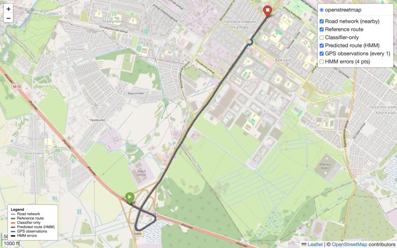
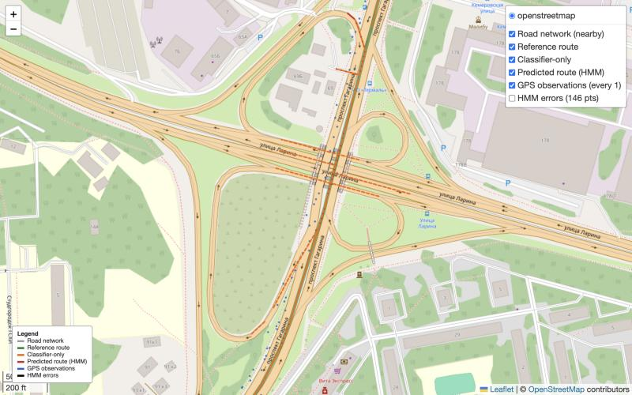

# Report Sections 5 and 6 (Role C)

> **Before submission:** the emission probabilities used here come from a distance-only baseline, because the trained classifier was not finished when these runs were made. Once B's probability files are in `results/`, run
> `python -m src.hmm_viterbi.experiment --probs-source b` and replace the tables in 5.6 and 5.7 with `results/hmm_bmodel/hmm_vs_classifier_summary.csv`. Every number below can be regenerated from the repository with `python -m src.hmm_viterbi.experiment` and `python -m src.hmm_viterbi.plots`.

---

## 5. HMM and Viterbi Route Reconstruction

### Overview

The candidate classifier scores each GPS point on its own. On its own, that produces routes a vehicle could not drive: the prediction flips between the two directions of a two-way street, or jumps to a road crossing underneath at an interchange. We add a hidden Markov model over the candidate arcs and decode it with the Viterbi algorithm, so the chosen arcs must also fit the road network and the timing between GPS points.

The HMM is the model: it defines how likely any sequence of arcs is. Viterbi is the algorithm that finds the most likely sequence without enumerating all of them.

Code: `src/hmm_viterbi/` (`viterbi.py` for the decoder, `network.py` for the road graph and shortest paths).

### 5.1 What are the hidden states in your implementation?

At GPS observation *t*, the hidden states are that observation's candidate arcs: the 8 nearest arcs within 50 m, found with a shapely STRtree. Each trip is projected to metres with its own azimuthal equidistant projection, centred on the trip.

- **What a state carries:** each state is an `arc_id` plus the observation's projected offset along that arc in metres. The offset is used to compute driving distances in 5.3.
- **Candidate-to-arc link:** the decoder only ever outputs one of an observation's own candidate `arc_id`s, so the link between candidates and road segments is preserved.
- **Candidate miss rate:** the share of points whose reference arc is not among their candidates is 3.11% on train and 0.41% on student-test (`results/candidate_miss_*.csv`). Most of the train misses come from the two misaligned trips described in 5.6.

### 5.2 How are emission probabilities calculated?

log E_t(j) = w · log p_t(j)

- **p_t(j):** the classifier's probability that arc *j* is the correct arc for observation *t*.
- **Floor:** probabilities are floored at 10⁻¹² so that a zero can't remove a candidate completely.
- **Weight:** w = 1.
- **Baseline used here:** p_t(j) is a Gaussian on the point-to-arc distance with σ = 5 m, normalised over the observation's candidates. This matches the typical GPS error we measured (median 5.7 m to the reference arc).

The decoder only needs one probability per candidate row, so B's classifier output replaces the baseline without any change to the decoder.

### 5.3 How are transition probabilities calculated?

log T(i → j) = −| d_route − d_gps | / β

- **d_gps** is the straight-line distance between GPS observations *t−1* and *t*.
- **d_route** is the driving distance on the road network from observation *t−1*'s position on arc *i* to observation *t*'s position on arc *j*. It is:
  - the remainder of arc *i*,
  - plus the shortest path from the end node of *i* to the start node of *j* (Dijkstra on the directed arc graph),
  - plus the offset on arc *j*.
- **Search limit:** the search stops at 2 · d_gps + 100 m, and results are cached per source node. Anything not reachable within that limit gets T = 0 (log −∞).

**Why this form:** between two fixes one second apart, a real vehicle drives about as far as the straight-line distance. A wrong-direction arc forces a long detour through the one-way graph, so its transition is heavily penalised. That is what separates the two directions of a street, which the distance baseline cannot.

β = 10 m was selected on train data (5.6).

**Same-arc jitter rule.** While a vehicle is stopped, GPS noise can make the projected offset move backwards along the arc. A strict model would read this as a U-turn, which is unreachable. Backward movement of up to `same_arc_tol` = 30 m on the same arc is therefore treated as standing still.

**Viterbi recurrence.** We work in log space, with backpointers:

S₀(j) = log E₀(j)
S_t(j) = max_i [ S_{t−1}(i) + log T(i → j) ] + log E_t(j),  B_t(j) = argmax_i [ … ]

The decoded route is read by backtracking from argmax_j S_T(j). Scores are re-centred at every step to avoid underflow.

**Cost:** with at most 8 candidates, each step compares 64 pairs. Decoding all 208,417 train observations took 3.9 s in total.

### 5.4 How are missing candidates or large GPS gaps handled?

- **No candidates at an observation:** the observation is skipped by the HMM. Afterwards it takes the arc decoded for the previous observation (or the next one, at the start of a trip), so every point still gets a prediction. With a nearest-arc fallback during candidate search, this did not happen in either partition.
- **Time gap over 60 s:** the chain is broken. After a long gap the driving distance can't be estimated from d_gps, so every state at *t* restarts from the best previous score plus its own emission: S_t(j) = max_i S_{t−1}(i) + log E_t(j). There were 69 such breaks in train and 1 in student-test. 60 s was chosen because about 97% of steps are 1 s apart, and longer gaps in the EDA were mostly parked vehicles or signal loss.

### 5.5 What happens when consecutive GPS observations suggest disconnected road segments?

If no candidate at *t* can be reached from any candidate at *t−1* within the search limit (every log T is −∞), we use the same chain break as for a gap.

**Why restart instead of forcing a jump:** restarting from the best previous state means one bad stretch can't wipe out the probability of the whole route. It also means a short wrong section can't force a long detour into the decoded route.

**Causes we saw:** GPS jumps, fragmented road networks (a median of 20 components per trip), and trips whose GPS track is offset from the map.

| Partition | Unreachable breaks | Of which in trip 00000054 |
|---|---|---|
| Train | 2,043 | 1,676 |
| Student-test | 12 | 0 |

Trip 00000054 is one of the two misaligned trips (5.6).

### 5.6 Did HMM decoding improve the final route?

Yes, clearly, with the baseline classifier. The decoder parameters were chosen on the 80 train trips only; the student-test trips were not used for any choice.

**Decoder tuning** (`results/decoder_tuning_train.csv`, `results/figures/decoder_tuning_train.png`). We searched 40 configurations: β ∈ {2, 5, 10, 20, 50} m, σ ∈ {5, 10} m, same_arc_tol ∈ {5, 15, 30, 60} m. The selection criterion was mean point accuracy over the train trips.

| same_arc_tol | Best mean train point accuracy |
|---|---|
| 5 m | 0.822 |
| 15 m | 0.892 |
| **30 m (selected)** | **0.898** |
| 60 m | 0.898 |

- **Selected configuration:** β = 10 m, σ = 5 m, same_arc_tol = 30 m, stored in `artifacts/hmm_config.json`.
- **Jitter tolerance mattered most:** it was the most influential parameter.
- **β mattered little:** once the tolerance was 30 m, the best accuracy for each β only ranged from 0.893 to 0.898.

**Classifier-only vs classifier + HMM** (`results/hmm_vs_classifier_summary.csv`; means over trips):

| Partition | Method | Point accuracy | Route continuity | Route precision | Route recall | Route F1 |
|---|---|---|---|---|---|---|
| Train (80) | Classifier only | 0.559 | 0.779 | 0.534 | 0.881 | 0.660 |
| Train (80) | Classifier + HMM | **0.898** | **0.966** | **0.959** | **0.964** | **0.961** |
| Student-test (10) | Classifier only | 0.551 | 0.804 | 0.534 | 0.906 | 0.667 |
| Student-test (10) | Classifier + HMM | **0.923** | **0.975** | **0.958** | **0.978** | **0.968** |

How the metrics are defined (`src/hmm_viterbi/metrics.py`):
- **Point accuracy:** the share of observations whose predicted arc equals the reference arc. The reference arc is assigned by monotone alignment of the points to `.route`, in `labels.py`.
- **Route continuity:** the share of consecutive observations whose predicted arcs are the same arc, or where the second starts at the first one's end node.
- **Route precision, recall and F1:** length-weighted overlap between the set of predicted arcs and the set of `.route` arcs (the sequence-level measures).

**Per student-test trip** (`results/hmm_vs_classifier_student_test.csv`). The HMM improved every trip, on every metric:

| Trip | Points | Accuracy: classifier only | Accuracy: + HMM | Continuity: classifier only | Continuity: + HMM |
|---|---|---|---|---|---|
| 00000000 | 2,503 | 0.484 | 0.961 | 0.905 | 0.996 |
| 00000007 | 1,354 | 0.457 | 0.992 | 0.926 | 1.000 |
| 00000009 | 1,049 | 0.439 | 0.857 | 0.648 | 0.935 |
| 00000040 | 2,995 | 0.574 | 0.979 | 0.896 | 0.997 |
| 00000052 | 262 | 0.798 | 0.985 | 0.766 | 0.966 |
| 00000056 | 3,958 | 0.681 | 0.949 | 0.760 | 0.966 |
| 00000065 | 768 | 0.694 | 0.820 | 0.804 | 0.977 |
| 00000076 | 1,486 | 0.451 | 0.902 | 0.743 | 0.952 |
| 00000077 | 3,911 | 0.349 | 0.848 | 0.851 | 0.988 |
| 00000091 | 874 | 0.585 | 0.934 | 0.740 | 0.971 |

Per-trip figures: `results/figures/point_accuracy_*.png`, `route_continuity_*.png`, `route_f1_*.png`.

**Why the improvement is so large.** In the median trip, 95% of arcs have a reverse twin, an arc with the same geometry in the opposite direction. A distance-only classifier can't tell the two apart. On trips 00000009, 00000076 and 00000077, 67–84% of the classifier-only errors were wrong-direction errors. The transition model removes most of them, because the reverse arc is not reachable from the previous arc within a plausible distance.

Most of the rest of the gain comes from junctions and interchanges, where the nearest arc is often a road crossing over or under the vehicle's road (Figure 6.2).

**Cases where HMM decoding did not help:**
- **Trip 00000010:** the only train trip where the HMM was slightly worse (0.537 vs 0.543 point accuracy). Most remaining errors on this trip, and on 00000016 (0.570), are on a different, unconnected road with a median distance of 27–39 m from the reference arc, which looks like a parallel road or service lane. Only 2–4% are wrong-direction errors. A distance-only emission can't separate parallel roads in the same direction, and when the parallel road is also reachable, the transition can't separate them either. Better emission features from the trained classifier are what should help here.
- **Trips 00000054 and 00000033:** the lowest train accuracies (0.086 and 0.236). These are data problems, not decoder failures:
  - In 00000054 the whole GPS track lies about 84 m (median) from any arc, and 90% of its points have no correct candidate.
  - In 00000033 the GPS follows the roads (7 m) but the supplied `.route` is about 122 m away.

  Person A flags both trips (`trip_flagged`). Without them, mean train point accuracy is 0.570 for classifier only and **0.917** with the HMM.
- **Continuity below 1.0:** continuity stays below 1.0 even with the HMM. At 1 Hz and high speed, a vehicle can cross a short arc (27% of route arcs are under 20 m) between two fixes. The decoded sequence then skips that arc, which the continuity metric counts as a break even though the route is drivable.

### 5.7 Limitations

- **Baseline emissions:** these results use a distance-only emission baseline. The classifier-only figures above are therefore a lower bound; B's classifier uses heading, speed and neighbouring-point features and should be much stronger. The HMM rerun on its probabilities is the result to report as final.
- **Label quality:** point-level reference labels are derived from `.route`, which is reference data, not verified truth. About 2% of consecutive route arcs are disconnected in some trips, and two trips don't match their GPS track.
- **Chain breaks:** a break keeps the decoder robust, but the route loses continuity at that point.

---

## 6. Geographical Visualisation Using Folium

Maps are generated from the actual pipeline output by `src/viz_folium/maps.py`:

```bash
python -m src.viz_folium.maps --trip data/student_test/00000052
```

The interactive maps are committed in `results/maps/`: student-test trips 00000009, 00000052, 00000065 and 00000076.

**Layers** (each can be switched on and off in the layer control):

| Layer | Style | Shown by default |
|---|---|---|
| Road network near the trip | grey thin lines | yes |
| GPS observations | blue dots; tooltip shows index and timestamp | yes |
| Reference route (`.route`) | green, thick, semi-transparent, so the predicted route is visible on top | yes |
| Predicted route, classifier + HMM | red | yes |
| Classifier-only route | orange, dashed | no |
| HMM error points (prediction ≠ reference) | black dots | no |
| Start and end markers | green and red pins | yes |

**Other features:**
- **Legend:** a fixed legend in the lower left.
- **Initial view:** the map opens zoomed to the extent of the GPS track.
- **Map size:** only arcs within 300 m of the track's bounding box are drawn, so maps of trips with up to 300k arcs stay usable.
- **UI version:** `trip_map(..., show_reference=False)` leaves out the reference layer, so ground truth never reaches the evaluator UI.

**Figure 6.1 — Student-test trip 00000052, full trip** (`results/figures/map_trip_00000052_overview.png`). The red HMM route follows the green reference route along its whole length; the HMM error layer reports only 4 mismatched points.



**Figure 6.2 — Student-test trip 00000076, interchange close-up** (`results/figures/map_trip_00000076_interchange.png`). The classifier-only route (orange dashes) jumps onto the roads crossing under the main road at the interchange, because they are the nearest arcs to some GPS points. The HMM route (red) stays on the main road, because those crossing roads are not reachable from the previous arc at the observed distance.



**A limitation of the maps:** a wrong-direction prediction is drawn exactly on top of the correct road. Most classifier-only errors are therefore invisible on a map, even though they are counted as errors. The HMM error layer, the black dots, shows these points.
